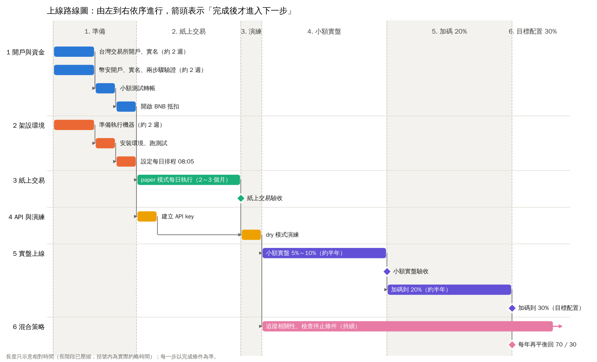

# 加密貨幣品質趨勢策略

幣安現貨的多幣種量化策略。從主流幣中挑選低波動、高流動性、且趨勢向上的幣集中持有，
包含完整的研究、驗證與自動交易程式，並與台股量化策略組成跨市場配置。

績效展示網站：[my-stock-rank](https://github.com/amu-0713/my-stock-rank)（加密貨幣策略頁、三策略混合頁，每天自動更新）



---

## 成果摘要

| 項目 | 結果 |
|---|---|
| 回測期間 | 2018-07 ～ 2026-10，日線，含已下市幣（避免倖存者偏差） |
| 年化報酬 | 70%（同期 BTC 買進持有 34%） |
| 最大回撤 | -28%（同期 BTC -77%） |
| Sharpe／Calmar | 1.70／2.46 |
| 交易成本 | 單邊手續費加滑價 0.1%，已計入 |
| 驗證後的合理預期 | 年化約 45%～60%，最大回撤約 -35%～-45% |
| 與台股策略的相關性 | 日報酬相關係數約 0.04 |

回測是最佳情況的估計，實際預期以驗證結果為準（見 [`docs/validation.md`](docs/validation.md)）。

## 策略概念

1. **幣池**：幣安主流幣，依成交額與上市時間篩選；只交易加密貨幣，排除穩定幣、槓桿代幣、代幣化股票與商品代幣。
2. **品質排序**：以低波動、高流動性評分，挑出品質較好的候選。
3. **趨勢確認**：只買價格趨勢向上、且相對 BTC 走強的幣，集中持有少數幾檔。
4. **空位處理**：條件不足時改持 BTC 或穩定幣，閒置資金放活期生息。
5. **出場**：持有中的幣跌破趨勢就自動賣出。
6. **風險控制**：依波動自動調整部位；資金分兩本帳，錯開時間調倉。

全部在幣安現貨帳戶內完成，不用合約、不放空、不加槓桿。完整規格見 [`docs/strategy.md`](docs/strategy.md)。

## 研究過程

研究不是一次到位，過程中放棄的方向也記錄下來：

- **主動買賣比因子**：小幣池看似有效，擴大到前 100 大後失效，訊號主要來自單一幣（BNB）。
- **動能因子**：在加密貨幣大幣中呈現反轉，不採用。
- **品質因子（低波動＋流動性）**：橫截面最穩定，成為選幣核心。
- **趨勢開關**：各幣自己的趨勢判斷，優於用 BTC 判斷整體多空。
- **測試後沒有改善而放棄**：ADX、ATR 出場、停損冷卻期、放空、資金費率套利、持有 10 檔、回撤控制等。
- **週日調倉其實是運氣**：檢定後不顯著，改成兩本帳分週四、週日錯開調倉。

## 驗證

| 方法 | 結論 |
|---|---|
| 參數隨機擾動（240 組） | 沒有任何一組年化為負，Sharpe 中位數 1.33；最終參數屬於偏樂觀的情況 |
| 前進式驗證 | 2020 年起滾動選參數，年化 76%、回撤 -29%，與固定參數接近 |
| 區塊拔靴法 | 最大回撤中位數 -33%，最差 5% 情境約 -47% |
| Deflated Sharpe | 假設試驗 5,000 次仍顯著 |
| 排除表現最好的幣 | 排除 BNB、ETH、SHIB 後年化仍有 58% |
| 前後兩半 | 2022 年下半年後明顯轉弱（年化約 30%），是主要隱憂 |
| 延遲成交 | 收盤後 6 小時內影響不大；延遲一天明顯變差 |
| 滑價與容量 | 100 萬 USDT 以內影響很小，容量約千萬美元等級 |
| 實盤程式重播 | 逐日重播 3 年，與回測日報酬相關係數 0.993 |

詳見 [`docs/validation.md`](docs/validation.md)。

## 自動交易程式

[`bot/`](bot/) 依策略規則在幣安現貨自動執行，只用 Python 標準函式庫加 pandas、numpy。

- **三種模式**：`paper`（紙上交易）、`dry`（讀真實帳戶、只印訂單）、`live`（實盤）。
- **與回測同一套邏輯**：訊號直接呼叫研究程式，資料清洗也共用。
- **安全機制**：
  - 下單遇到網路錯誤不重送，避免重複成交。
  - 每次執行前用實際餘額對帳。
  - 有 `STOP` 檔就緊急停止。
  - 同一根日 K 只處理一次。
  - 狀態檔自動備份。
- **API key**：只用環境變數提供，權限不開提幣。

使用方式見 [`bot/README.md`](bot/README.md)。

## 跨市場配置

與兩個台股策略（動態多因子、高息低波）的日報酬相關係數都接近 0。三策略混合後，回撤和波動明顯低於單一策略，
Sharpe 也較高。分析見 [`docs/portfolio_mix.md`](docs/portfolio_mix.md)，可在網站的三策略混合頁即時試算。

## 專案結構

```
tools/
  factor_research.py    研究與回測引擎（因子、選幣、回測、波動目標、績效）
  download_binance.py   下載幣安現貨日 K（含已下市幣）
  export_web.py         匯出網站資料；--update 每日增量更新
  plot_roadmap.py       產生上線路線圖
bot/                    自動交易程式（run.py、engine.py、brokers.py、binance_api.py、replay.py、test_bot.py）
docs/
  strategy.md           策略規格與回測結果
  validation.md         驗證報告
  portfolio_mix.md      與台股策略的混合配置
  roadmap.md            上線路線圖
```

## 快速開始

```bash
pip install pandas numpy

# 1. 下載資料（輸出 data/spot/1d）
python tools/download_binance.py

# 2. 回測（參數見 docs/strategy.md）
python tools/factor_research.py --data data/spot/1d ...

# 3. 測試與紙上交易
python bot/test_bot.py
python bot/run.py --mode paper --capital 10000
```

## 免責聲明

本專案為個人研究，所有數字皆為歷史回測，不代表未來報酬，也不構成任何投資建議。
加密貨幣波動極大，可能損失全部本金。
