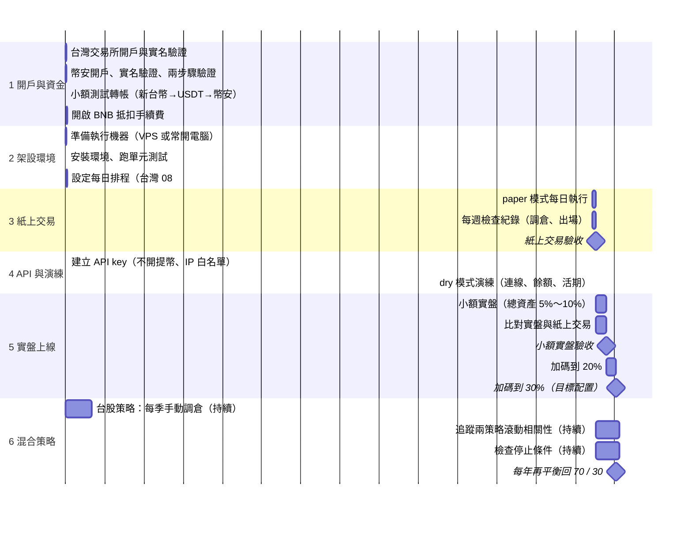

# 上線路線圖：開戶 → 架設 → 實盤 → 混合策略

不標示實際日期，長度只代表相對時間；每一階段以「完成條件」為準，達成才進入下一階段。

## 各階段完成條件

| 階段 | 完成條件 |
|---|---|
| 1 開戶與資金 | 兩個交易所都完成實名與兩步驟驗證；小額轉帳成功到帳；BNB 抵扣已開啟並存入少量 BNB |
| 2 架設環境 | `python bot/test_bot.py` 全部通過；排程能在每天台灣 08:05 自動執行並產生紀錄 |
| 3 紙上交易 | 連續執行 2～3 個月沒有中斷或錯誤；每週日、週四的調倉與每日出場都符合規則 |
| 4 API 與演練 | `dry` 模式能正確讀取餘額與活期、印出的訂單合理 |
| 5 實盤上線 | 小額實盤約半年、成交與紙上交易一致、表現在預期範圍內 → 加碼到 20%；再約半年仍正常 → 加碼到 30% |
| 6 混合策略 | 持續進行：台股每季手動調倉；每年再平衡回 70 / 30 |

## 持續檢查的停止條件

| 情況 | 處理 |
|---|---|
| 幣圈實盤回撤超過 -45% | 停止，重新評估策略 |
| 幣圈實盤滿一年 Calmar 低於 0.5 | 降回較低比例並重新評估 |
| 實盤與紙上交易的成交明顯不一致 | 先停下（`bot/STOP`），查明原因 |
| 兩策略滾動 52 週相關長期超過 0.4 | 重新評估 70 / 30 配置 |
| 交易所重大風險事件 | 立即降低幣圈比重或暫停 |

相關文件：`docs/strategy.md`（策略規格）、`docs/validation.md`（驗證）、`docs/portfolio_mix.md`（混合配置）、`bot/README.md`（程式使用）。
